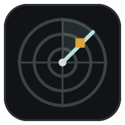

<p align="center"></p>

# RadarSim

A radar simulator that runs the physics one look at a time and shows the result the
way a radar console would. I use it to answer questions like: when is this fighter
first detected, how far does a self-screening jammer push that out, why does the track
break in a 5 g turn, and what does sea clutter do to a missile at 5 m altitude.


**Documentation:** <https://spaceengineerss.github.io/RadarSim/>

## What is in it

- **Detection.** The radar equation with pulse compression, Swerling 0–4 targets,
  non-coherent integration and CFAR loss. A target is only looked at when the beam
  crosses it, so detections and tracks arrive at the real revisit rate.
- **Environment.** ITU-R P.676 gases, P.838 rain with the P.839 rain height, terrain
  masking on a 4/3 Earth, land, sea and rain clutter through the elevation beam, MTI.
- **Electronic attack.** Noise jamming with burn-through, DRFM range and velocity
  gate pull-off, chaff and decoys released during the run.
- **Tracking.** Track-while-scan, Hungarian assignment with χ² gates, two-point
  initiation, Kalman and EKF filters, monopulse angles.
- **Signal level.** A coherent pulse-Doppler chain (LFM matched filter, MTI,
  Doppler FFT, CA/GO/SO/OS CFAR) and range-Doppler SAR focusing.
- **Tools.** Pd–range coverage diagram, Monte Carlo runs with confidence intervals,
  an event log with report export, and a scenario editor that draws on the scope.

Every model names its source and validity range, and each one is tested against a
closed-form result or published values. The suite has 421 tests.

<table>
<tr>
<td></td>
<td></td>
</tr>
<tr>
<td></td>
<td></td>
</tr>
</table>

## Install

Python 3.9 to 3.12.

```bash
pip install "radarsim[gui] @ git+https://github.com/SpaceEngineerSS/RadarSim.git"
radarsim
```

Ready-to-run builds for Windows, Linux and macOS are attached to each
[release](https://github.com/SpaceEngineerSS/RadarSim/releases). From a checkout:

```bash
git clone https://github.com/SpaceEngineerSS/RadarSim.git
cd RadarSim
python -m venv .venv
.venv/bin/pip install -e ".[gui]"        # .venv\Scripts\pip on Windows
.venv/bin/radarsim
```

## First five minutes

1. `radarsim f16_vs_sa6` opens the SEAD scenario. Press <kbd>Space</kbd>.
2. Watch F-16 Alpha stay hidden behind its jammer while Bravo is tracked from the start.
3. Click a contact: the inspector shows its SNR, Pd and every loss term at the last look.
4. Turn **Jammers** off in the settings panel and see Alpha appear on the next sweep.
5. Open **Coverage** to see the Pd–range curve for the radar you just changed.

Without the interface:

```text
$ radarsim --headless f16_vs_sa6 --duration 120 --seed 3
F-16 vs SA-6 Air Defense  (120 s simulated in 0.70 s)
object                      looks   det     Pd  first det [s]  median SNR [dB]
F-16 Alpha                     12     0   0.00              -             -9.7
F-16 Bravo                     12    12   1.00            7.4             39.6
Chaff 1                         6     6   1.00           67.7             51.9
ADM-160 MALD                    9     9   1.00           37.7             42.2
tracks: 3 (3 confirmed)
```

From Python:

```python
from radarsim.io.scenario_loader import ScenarioLoader, resolve_scenario

engine = ScenarioLoader(resolve_scenario("naval_battlegroup")).create_simulation_engine()
engine.seed = 7
log = engine.run(60.0)
```

## Scenarios

| Scenario | What it shows |
|---|---|
| `basic_tracking` | three targets of different RCS and Swerling case, track life cycle |
| `close_air_combat` | fighter AESA sector scan, a 4.7 g break with a DRFM |
| `drone_swarm_saturation` | thirty small drones and the limits of data association |
| `ecm_environment` | barrage jamming and DRFM deception over the sea |
| `f16_vs_sa6` | SEAD package: escort jammer, chaff and a MALD decoy |
| `ground_clutter_filtering` | land clutter sectors and the MTI canceller |
| `hypersonic_interception` | a staring Ka-band seeker against a glide vehicle |
| `mountain_ambush` | terrain masking and pop-up detection |
| `naval_battlegroup` | sea clutter against sea-skimming missiles |
| `stealth_deep_penetration` | a 0.01 m² bomber against a UHF early-warning radar |

Scenarios are YAML or JSON files with a checked schema; the
[format reference](https://spaceengineerss.github.io/RadarSim/scenario-format/) covers
every key.

## Limits

RadarSim is an engineering and teaching tool, not a certified performance predictor,
and none of its parameters are real equipment data. Propagation has no ducting or
multipath, targets are point scatterers, tracks are two-dimensional and the filters
are single-model. Each model page in the documentation lists its own limits.

## Development

```bash
pip install -e ".[gui,dev,docs]"
pytest && ruff check . && mkdocs serve
```

See [CONTRIBUTING.md](CONTRIBUTING.md) and the
[development notes](https://spaceengineerss.github.io/RadarSim/development/).

## Licence and citation

MIT, see [LICENSE](LICENSE). The bundled IBM Plex fonts are under the SIL Open Font
Licence. If RadarSim contributes to published work, please cite it using
[CITATION.cff](CITATION.cff) and give the version, scenario file and seed.
