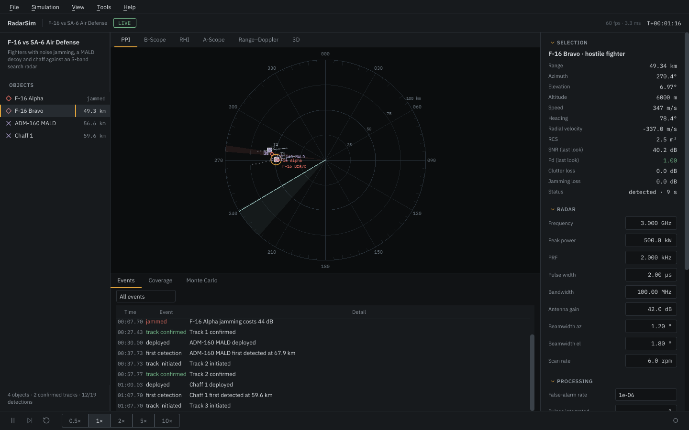

# RadarSim

RadarSim is a radar simulator I wrote to study how a surveillance or fire-control
radar actually behaves: when a target is first detected, why a track is lost in a
hard turn, how much a self-screening jammer hides an aircraft, what sea clutter does
to a sea-skimming missile. It runs the physics look by look, shows the result the way
a radar display would, and lets you change the radar while it runs.

## What it models

- **Detection** from the radar equation with pulse compression, Swerling 0–4 targets,
  non-coherent integration and CFAR loss. A target is looked at only when the beam
  passes over it, so detections and tracks arrive at the real revisit rate.
- **Propagation**: ITU-R P.676 gaseous absorption, ITU-R P.838 rain with a P.839 rain
  height, and line of sight over procedural or hand-placed terrain on a 4/3 Earth.
- **Clutter**: constant-γ land clutter, the Oh–Sarabandi–Ulaby bare-soil model, the
  NRL sea-clutter model, rain volume clutter, all entering through the elevation
  beam, plus an MTI canceller with the Skolnik improvement factor.
- **Electronic attack**: barrage and spot noise jamming with burn-through, DRFM range
  and velocity gate pull-off, chaff clouds and decoys released during the run.
- **Tracking**: track-while-scan with global nearest-neighbour assignment, χ² gating,
  two-point initiation and Kalman/EKF filters; monopulse angle measurement.
- **Signal level**: a coherent pulse-Doppler chain (LFM matched filter, MTI, windowed
  Doppler FFT, CA/GO/SO/OS CFAR) and range-Doppler SAR focusing.

Every model states its references and validity range in the code, and the test suite
checks each one against closed-form results or published values
([Validation](validation.md)).

## Where to start

| If you want to | Go to |
|---|---|
| install it and open a scenario | [Getting started](getting-started.md) |
| learn the window, scopes and shortcuts | [The interface](interface.md) |
| see what each shipped scenario demonstrates | [Built-in scenarios](scenarios.md) |
| write your own scenario | [Writing scenarios](scenario-format.md) |
| run batches without the GUI or use the library | [Command line and Python](headless.md) |
| check an equation | [Models](models/detection.md) |

## Licence and citation

RadarSim is MIT-licensed. If you use it in published work, please cite it using
`CITATION.cff` in the repository.
