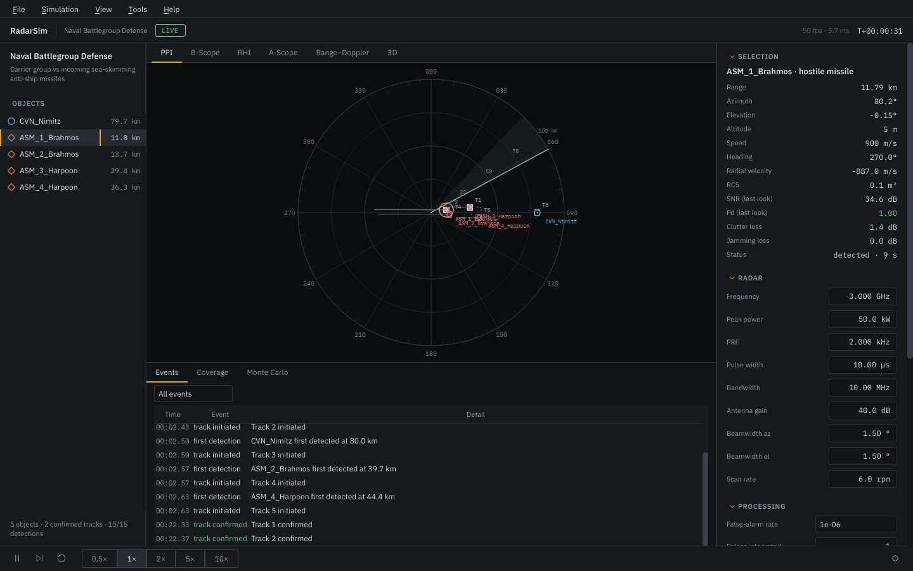
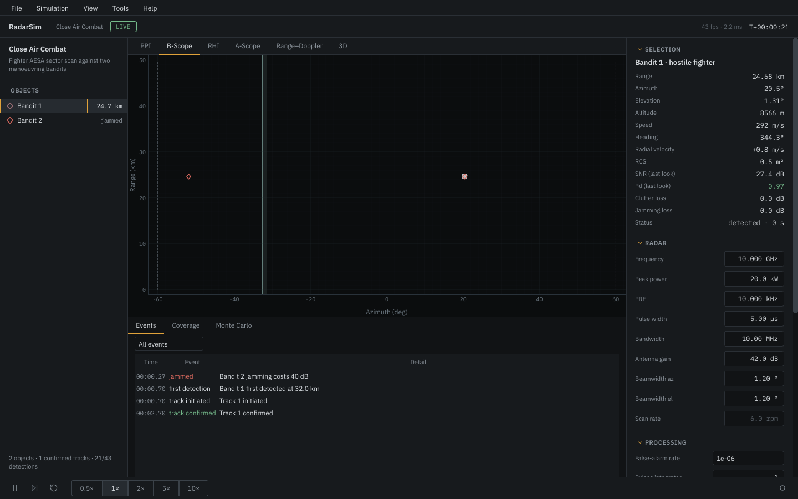
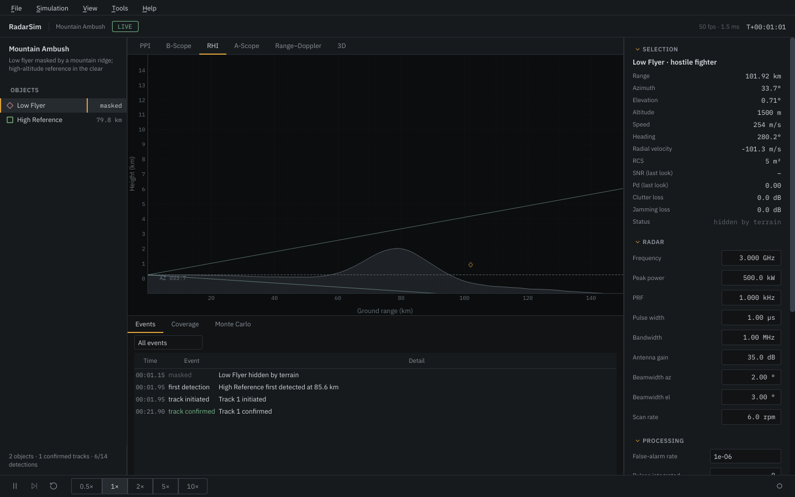
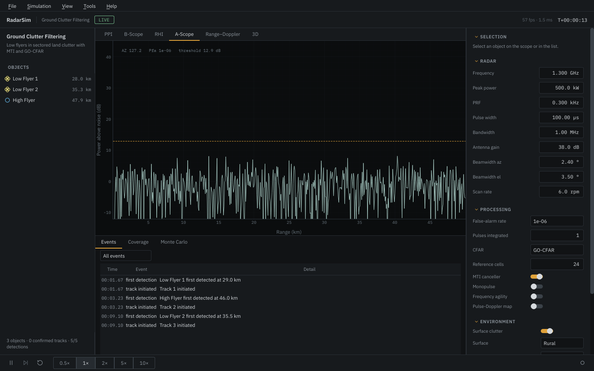
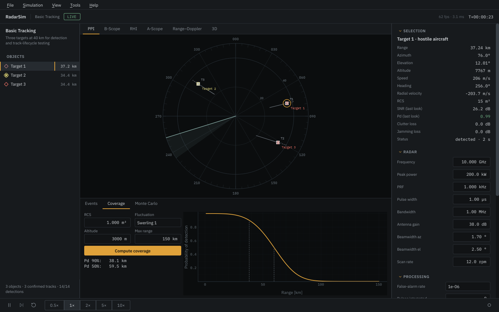
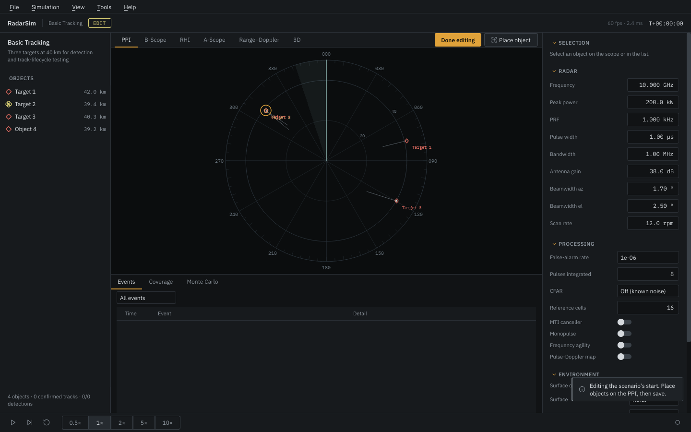

# The interface

The window has five parts:

- **Header**: scenario name, mode (`LIVE`, `PAUSED`, `REPLAY`, `EDIT`), simulated time
  and the current display rate.
- **Objects** (left): every object in the scene with its range, or `masked` /
  `jammed`. Chaff and decoys appear when they are released.
- **Scopes** (centre): six views of the same picture, switched with the tabs or the
  keys 1–6.
- **Inspector and settings** (right): the selected object, then the radar,
  processing, environment and electronic-attack settings.
- **Drawer and transport** (bottom): events, coverage and Monte Carlo tabs above the
  play/pause, step, restart, speed and record controls.

## Scopes

**PPI**: plan position indicator, North up, centred on the radar. Plots (small dots)
appear only where the beam has looked and fade over one revisit period. Track
symbols are squares: hollow while tentative, filled when confirmed, amber while
coasting, with a one-minute velocity leader and a 2σ uncertainty ellipse. Ground
truth uses the NATO affiliation shapes and colours (circle friend, diamond hostile,
square neutral, quatrefoil unknown; × for chaff and decoys) and can be hidden with
`T` to see only what the radar knows. A noise jammer shows as a red strobe along its
bearing.

**B-scope**: azimuth against range. For sector-scanning radars the horizontal axis
is the sector.

**RHI**: height against ground range along one bearing, with the terrain profile and
the elevation beam. It follows the selected object, otherwise the antenna. Heights
are drawn relative to the radar's tangent plane, so the Earth curves away below the
horizontal.

**A-scope**: power above noise along the current beam. Noise is a fresh
square-law realization each frame. The dashed line is the detection threshold for
the configured false-alarm rate plus the CFAR loss; a noise jammer in the beam raises
the floor by its jammer-to-noise ratio.

**Range–Doppler**: the output of the coherent pulse-Doppler processor (matched
filter, MTI, Hamming-windowed Doppler FFT). It is off by default because it is the
most expensive part of a step; switch it on from the view or in the settings.
Dashed lines mark the blind speeds.

**3D**: an OpenGL view of the scene and the terrain. It loads the first time you open
it; on machines without OpenGL it shows a note and the rest of the program is not
affected.

## Settings

Every field writes straight to the running simulation, and the panel is read back
from the simulation when a scenario loads, so what you see is what is simulated.
Hover a label for a short explanation. Values use the units shown in the field
(GHz, kW, µs …).

## Analysis drawer

- **Events**: first detections, tracks initiated, confirmed and lost, terrain
  masking, jamming and burn-through, with a filter. **File › Export report**
  writes these together with a per-object summary (looks, detections, first
  detection range, median SNR) as CSV or JSON.
- **Coverage**: single-look Pd and SNR against range for a probe target, computed
  with exactly the physics of the current run. The 50 % and 90 % detection ranges are
  printed next to the plot.
- **Monte Carlo**: repeats independent looks at a set of ranges and plots the
  empirical Pd with 95 % Wilson intervals against the theoretical curve.

## Scenario editor

**Tools › Scenario editor** (Ctrl+Shift+E) pauses the run and rewinds it to the start.
**Place object** puts a new aircraft where you click on the PPI, heading for the
radar; the inspector then edits its name, affiliation, RCS, fluctuation model,
altitude, speed, heading and turn rate. **File › Save scenario as** writes the
result in the normal scenario format. **File › New scenario** starts from an empty
scene.

## Recording and replay

The record button (Ctrl+R) writes the session to an HDF5 file in the application
data folder. **File › Open recording** plays it back with a time slider; the speed
buttons work in replay as well.

## Performance

The simulation advances in fixed steps on its own thread, independent of how fast the
screen is redrawn. The display aims for 60 frames per second, extrapolates motion
between simulation frames, draws only the visible scope, and drops to 30 or 20 frames
per second by itself when frames take too long. **View › Performance › Light** fixes
30 frames per second and turns off antialiasing and the sweep afterglow for older
machines. **View › Reduce motion** turns off interface animations.

## Keyboard

| Key | Action |
|---|---|
| Space | play / pause |
| . | single step while paused |
| R | restart the scenario |
| 1 … 6 | PPI, B-scope, RHI, A-scope, range–Doppler, 3D |
| + / − or mouse wheel | range scale |
| F | fit all objects |
| T | ground truth on/off |
| Esc | clear selection |
| Ctrl+O / Ctrl+S | open / save scenario |
| Ctrl+E | export report |
| Ctrl+R | record |
| Ctrl+J | show or hide the drawer |
| F11 | full screen |

## Language

**View › Language** switches between English and Turkish; the change applies after a
restart.
