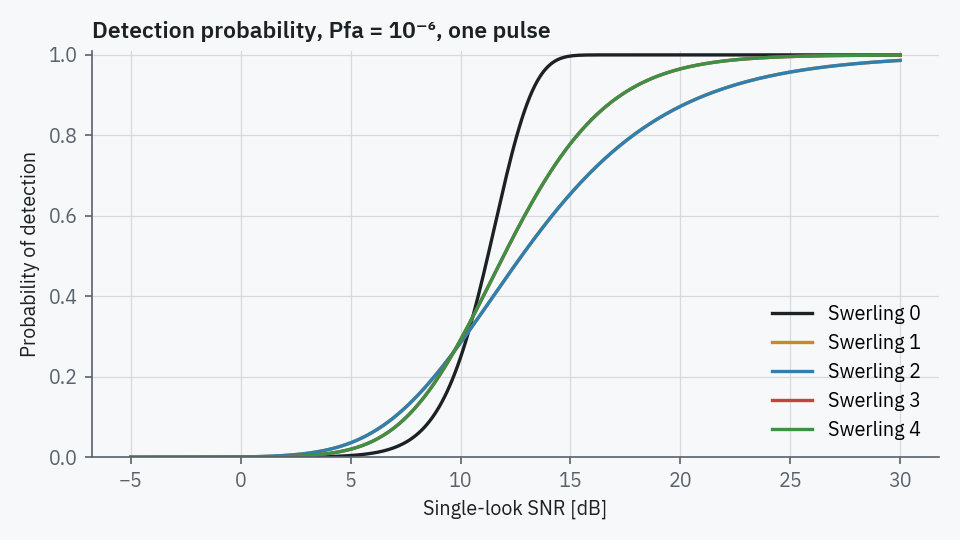
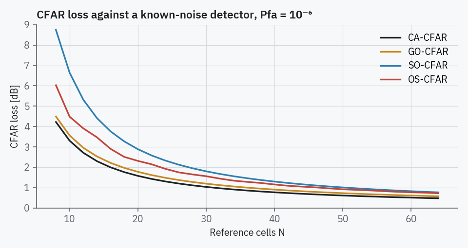
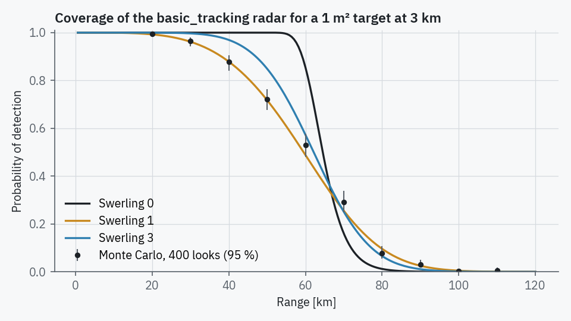

# Detection

Code: `radarsim/simulation/engine.py` (`SimulationEngine.step`),
`radarsim/physics/radar_equation.py`, `radarsim/physics/metrics.py`.

## When a target is looked at

A rotating antenna only illuminates a target while its beam passes over it. RadarSim
records, for every engine step, the azimuth interval the beam centre swept
(`Radar.swept_legs`) and gives a target exactly one detection opportunity, a *look*,
in the step in which the beam centre crosses its azimuth. A circular scan therefore
looks at each target once per revolution, a sector raster twice per cycle, and a
staring antenna on every step while the target is in the main lobe.

The pulses that hit the target during the dwell are represented by the
non-coherent integration count `pulses_integrated`.

Between looks the full physics chain is not evaluated; the last look's SNR and Pd are
carried forward with updated geometry. With 30 targets this keeps a step near 1 ms.

## SNR of one look

Receiver-input SNR from the monostatic radar equation (Skolnik 2008, eq. 2.6):

\[
\mathrm{SNR}_{in} = \frac{P_t G^2 \lambda^2 \bar\sigma}{(4\pi)^3 R^4 \, k T_0 F B \, L_s L_a}
\]

with \(\bar\sigma\) the aspect-weighted *mean* RCS, \(L_s\) the system losses and
\(L_a\) the two-way propagation loss. The matched filter adds the time-bandwidth gain
\(G_c = \max(1, \tau B)\) for the signal only. Noise, noise jamming and clutter are
combined after the matched filter as inverse SNR terms (Richards 2005, §2.4, §4.6):

\[
\mathrm{SINR} = \left( \frac{1}{G_c\,\mathrm{SNR}_{in}} + \frac{J/S}{G_c}
+ \frac{\sigma_c}{\bar\sigma} \right)^{-1}
\]

Thermal noise and barrage jamming are white over the receiver band and gain nothing
from compression; clutter is an echo of the same waveform, so it is compressed like
the target, and its resolution cell uses the compressed pulse length
\(\tau_c = \min(\tau, 1/B)\). The receiver hard limiter is applied to the
receiver-input powers, and any clipping loss is subtracted at the end.

## Probability of detection

The Swerling fluctuation is *not* sampled: SNR uses the mean RCS and Pd averages over
the fluctuation statistics, which is what Swerling's results describe. The threshold
of the square-law detector integrating \(N\) pulses is set from the false-alarm
probability, \(P_{fa} = Q(N, T)\), and

| Case | Pd |
|---|---|
| 0 | non-central χ² survival, \(\Pr\{\chi'^2_{2N}(2N\,\mathrm{SNR}) > 2T\}\) |
| 1, 3 | the Swerling 0 result averaged over an exponential (1) or χ²₄ (3) RCS, constant over the dwell |
| 2, 4 | the same averaged over the sum of \(N\) independent per-pulse RCS values |

Cases 1 and 2 use their exact closed forms (DiFranco & Rubin 1968); for case 2 the
integrated statistic is simply \((1+\mathrm{SNR})\,\Gamma(N)\). Cases 3 and 4 are
averaged numerically over the RCS distribution with Gauss–Legendre rules split at the
detection knee, accurate to about \(10^{-5}\)
(`radarsim.physics.metrics.calculate_pd_swerling`). All five are checked against a
pulse-level Monte Carlo in the test suite.

## CFAR loss

An adaptive threshold estimated from \(N\) reference cells needs more SNR than a
detector that knows the noise level. RadarSim computes this CFAR loss for CA, GO, SO
and OS (rank \(3N/4\)) detectors from the exact single-pulse Swerling-1 expressions
(Gandhi & Kassam 1988; Rohling 1983) at \(P_d = 0.5\) and subtracts it from every
look's SINR before Pd is evaluated.

| N | CA | GO | SO | OS |
|---|---|---|---|---|
| 16 | 2.00 dB | 2.21 dB | 3.76 dB | 2.90 dB |
| 24 | 1.30 dB | 1.48 dB | 2.33 dB | 1.92 dB |
| 32 | 0.97 dB | 1.12 dB | 1.67 dB | 1.44 dB |

(Pfa = 10⁻⁶.)

## Measurements

A detected look produces a range and two angles with Gaussian errors
(`range_noise_std_m`, `angle_noise_std_rad`) or, with monopulse enabled, angles from
the sum/difference estimator ([Tracking](tracking.md#monopulse)). The measured
position, converted to the ground plane, goes to the tracker.

## Coverage

**Coverage** in the analysis drawer evaluates this chain for a probe target over
range. Free-space detection range at fixed SNR grows as \(\sigma^{1/4}\); the test
suite checks this to 2 %.

