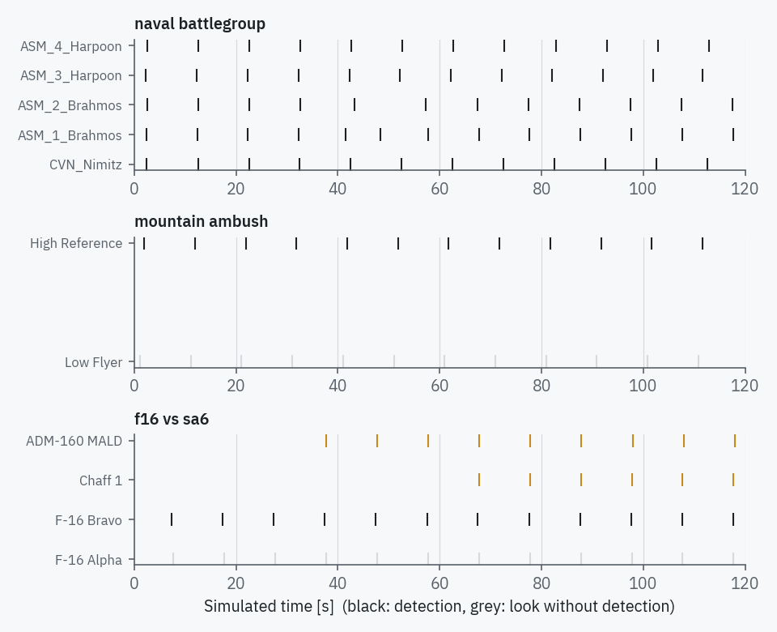

# Built-in scenarios

Each scenario is a small YAML or JSON file under `radarsim/scenarios/`. They are
written to show one effect clearly, and the test suite checks that each one still
does what is described here (`tests/test_scenarios.py`).

Run any of them from **File › Built-in scenarios**, or without the interface with
`radarsim --headless <name>`.

## basic_tracking

X-band surveillance radar (10 GHz, 200 kW, 12 rpm) and three targets at about
40 km: a 15 m² aircraft, a 5 m² fighter (Swerling 3) and a 0.5 m² cruise missile at
100 m (Swerling 2). All three are detected on every scan and confirmed after three
scans. A good place to learn the scopes and the track life cycle.

## close_air_combat

A fighter AESA rasters ±60° about North at 120°/s from 8 km while flying North at
250 m/s. Bandit 1 breaks right at 9°/s (about 4.7 g) and carries a DRFM;
Bandit 2 drifts out of the sector to the West behind a spot-noise jammer. Shows
sector scanning in the B-scope, a single unbroken track through a hard turn (the
scenario sets the tracker's process noise to 40 m/s²) and a target that is lost
because it leaves the scan volume rather than because of detection.

## drone_swarm_saturation

Thirty 0.01 m² drones in three ranks approach a C-band radar. Single-look SNR is
around 20 dB at 15 km, so most looks detect, but the drones are close together and
the tracker initiates and drops tracks as associations swap. Useful for looking at
data-association limits.

## ecm_environment

Low-power X-band radar over sea state 2 with a 500 W barrage jammer on a bomber and
a DRFM on a fighter. The bomber stays hidden (jamming costs about 35 dB), the
fighter is detected intermittently.

## f16_vs_sa6

S-band search radar (500 kW, 100 MHz pulse compression, CA-CFAR) against two F-16s
coming in from the West. Alpha runs a 200 W barrage jammer and is never detected;
it releases an ADM-160 MALD at 30 s and a chaff cloud at 60 s, both from its own
position. The decoy and the chaff are detected and tracked within one scan of their
release, while Bravo is tracked from about 73 km.

## ground_clutter_filtering

L-band radar on a 30 m tower over land with urban, rural and forest clutter sectors.
Two low flyers sit in clutter; a two-pulse MTI and a 24-cell GO-CFAR bring them out
(SCR around 30 dB with MTI). Switch **MTI canceller** off in the settings to watch
the clutter loss jump and the low flyers drop out.

## hypersonic_interception

A Ka-band seeker at 20 km altitude stares East at a glide vehicle closing at about
3 km/s. The seeker first detects it at roughly 14 s. The radial speed is far beyond
the unambiguous Doppler of the 100 kHz PRF, which the range–Doppler view shows when
pulse-Doppler processing is switched on.

## mountain_ambush

A ground radar 30 m above the terrain, a 2.5–3 km ridge to the North-East
(procedural relief plus three Gaussian peaks), and a low flyer running West behind
it at 1500 m. The flyer is masked until it clears the northern end of the ridge at
about 2½ minutes; MTI then lifts it out of the mountain clutter. A high-altitude
aircraft to the East is visible throughout.

## naval_battlegroup

S-band naval radar on a 35 m mast, NRL sea clutter at sea state 4, a carrier at
80 km and four sea-skimming missiles (0.1–0.15 m², 5–8 m above the water). Pulse
compression (10 µs, 10 MHz) and MTI keep the clutter loss to a few dB, and all four
missiles are detected on the first scan. Switch MTI off to see sea clutter take over.

## stealth_deep_penetration

UHF early-warning radar (450 MHz, 400 kW, 200 µs pulse) and a 0.01 m² bomber
starting 250 km out. RadarSim's RCS does not depend on frequency, so the value in the
file should be the one that applies at the radar frequency; with this value the
bomber is first detected near the end of the five-minute run.

!!! note "Limitations worth knowing"
    The detection model assumes the target sits in an unambiguous range cell; range
    ambiguities of high-PRF waveforms appear only in the pulse-Doppler processor.
    RCS is aspect dependent (broadside-weighted) but frequency independent.
