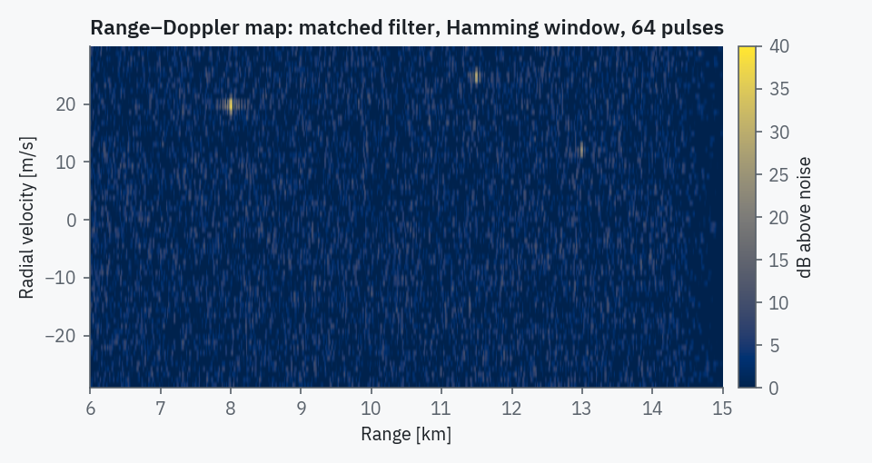

# Validation

RadarSim's test suite has 421 tests. They run on every push for Python 3.9 to 3.12 on
Linux, and on Windows and macOS. Most of them compare a model with an independent
result rather than with its own earlier output.

```bash
pip install -e ".[gui,dev]"
pytest                              # about 40 s
```

## What is checked

| Area | Reference used by the tests |
|---|---|
| Radar equation | Skolnik 2008, example 2.1: SNR 17.26 dB to within 0.01 dB |
| Detection range | free-space range grows as σ^¼ to within 2 % |
| Swerling Pd, cases 0–4 | pulse-level Monte Carlo of a square-law detector, 200 000 looks, 1 and 8 pulses |
| Albersheim | inverse consistency with the exact Pd |
| CFAR multipliers (CA, GO, SO, OS) | measured false-alarm rate on exponential noise |
| CFAR loss | ordering SO > OS > GO > CA and known CA values |
| ITU-R P.676-13 | ITU validation workbook, 12 significant digits |
| ITU-R P.838-3 | published coefficients |
| Sea clutter | NRL model reference values |
| Doppler | \(f_d = -2v_r/\lambda\), sign and magnitude |
| Pulse-Doppler chain | matched-filter gain τB, peak in the right range and velocity bin, MTI null at DC |
| Antenna pattern | half power at half the 3 dB beamwidth |
| Kinematics | constant velocity, constant acceleration, exact coordinated turn on a circle |
| Terrain | mountain peaks block the ray, flat terrain does not |
| Tracking | straight-line convergence, NIS consistency, confirmation through a 4.7 g turn without a break |
| Jamming | J/S scaling with range and bandwidth, burn-through consistency |
| Receiver limiter | complex-Gaussian closed form at full scale |
| Determinism | same seed gives identical runs; reset reproduces a run exactly |
| Scenarios | every shipped scenario has no unknown keys, survives export and reload unchanged, and does what its description says (`tests/test_scenarios.py`) |
| Interface | every scenario loads with its radar values intact, every scope renders, settings reach the engine, editor round trip, recording and replay, a bad file leaves the run going |

`tests/test_known_defects.py` keeps one test for each defect fixed during the 4.0
overhaul, so none of them can come back unnoticed.

## Monte Carlo against theory

The coverage curve of the `basic_tracking` radar for a 1 m² target, with empirical
detection rates from 400 independent looks per range and their 95 % Wilson
intervals:


## Signal-level output

A range–Doppler map from the coherent processor: three targets, LFM pulse
compression, Hamming-windowed 64-point Doppler FFT. Closing targets appear at
negative radial velocity.



## Reproducing the figures

```bash
python tools/make_figures.py          # docs/assets/figures
python tools/capture_screenshots.py   # docs/assets/screens
```
